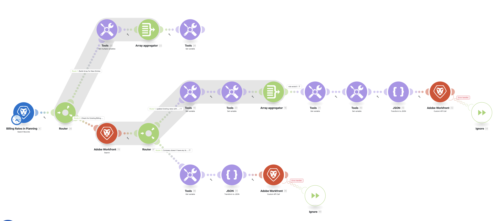
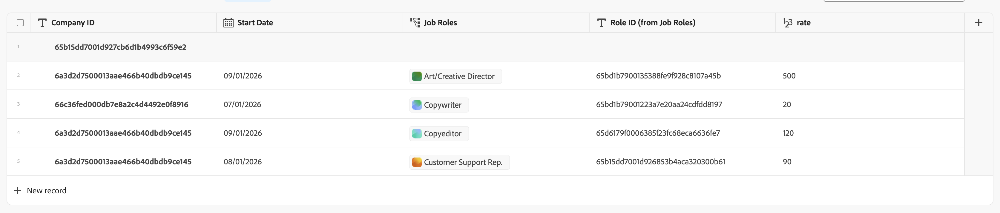

# Company Billing Rates

Syncs billing rates from **Workfront Planning** into **Workfront's native billing rate system**, keyed by company + job role.

## What It Does

Reads "company rates" records from a Planning workspace and upserts them into Workfront's RATE object. For each Planning record that has a rate set, it either:

- **Creates** a new billing rate entry if the company+role combination has no existing rates
- **Updates** existing rates, appending the new rate with a start date and automatically closing out the previous rate's end date

## Blueprint File

`company_rate_blueprint-302403.json`

## Data Model (Planning → Workfront)

| Planning Field | Workfront Field |
|---------------|-----------------|
| Company ID | `RATE.companyID` (via `attachableID`) |
| Role ID (from Job Roles) | `RATE.roleID` |
| rate | `RATE.value` |
| Start Date | `RATE.startDate` |

The screenshot below shows what the source records look like in the Workfront Planning record type view:

## Import Instructions

1. Open Workfront Fusion
2. Create a new scenario
3. Click `...` → **Import Blueprint**
4. Select `company_rate_blueprint-302403.json`
5. Reconnect the Workfront and Workfront Planning connections after import (the blueprint references connection ID `94619` which is environment-specific)

## Notes

- The scenario queries Planning with a filter for non-empty `rate` — records without a rate value are skipped
- When updating existing rates, the previous rate's `endDate` is set to `startDate - 1 day` to avoid gaps or overlaps
- Errors on individual RATE writes are ignored so the scenario continues processing remaining records
